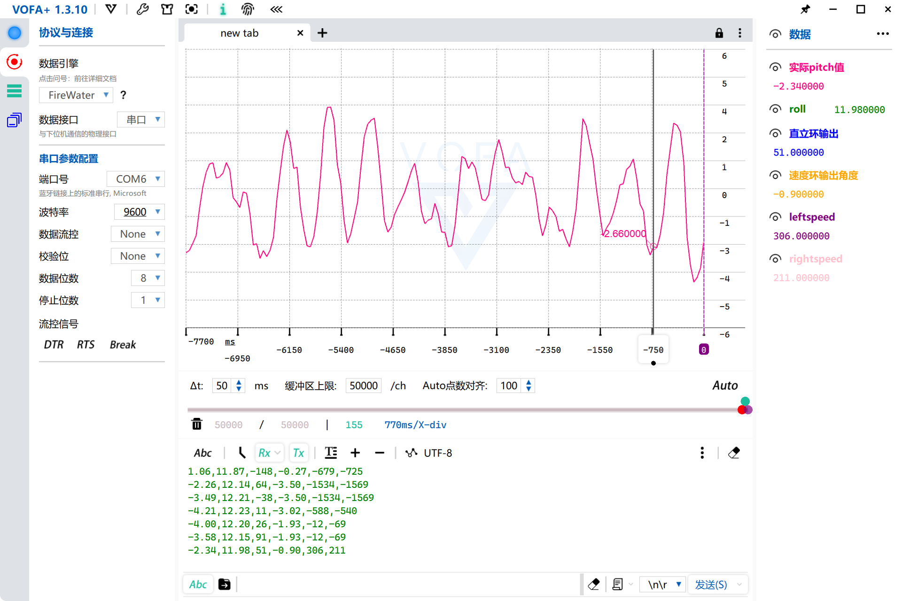
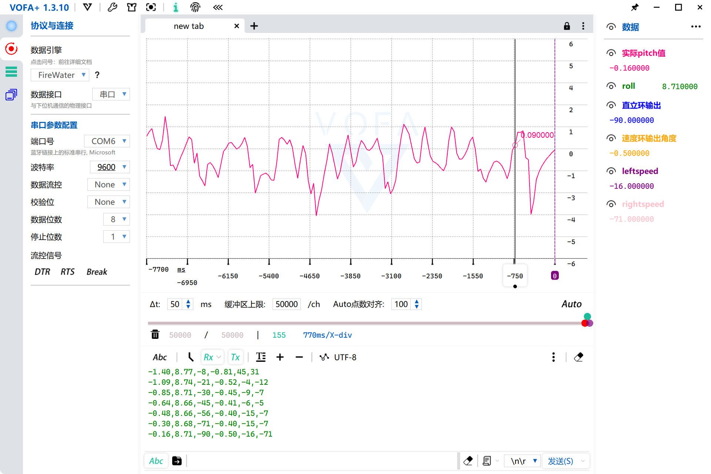
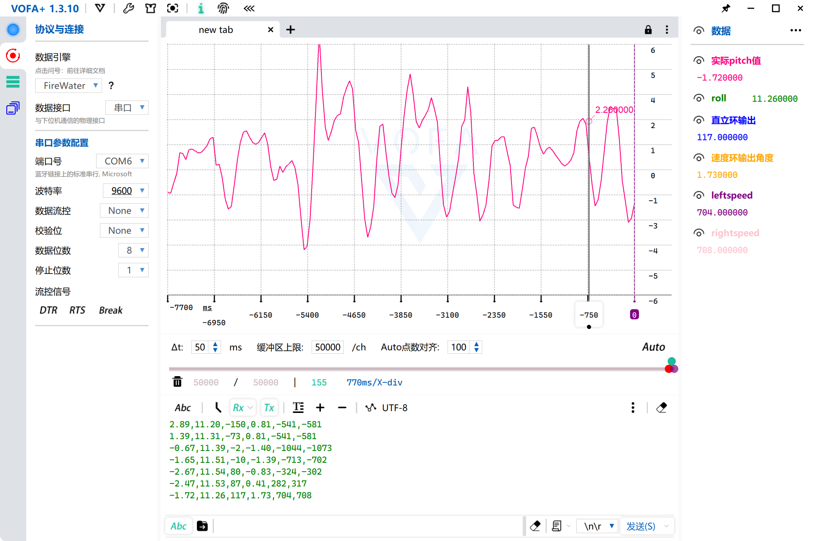
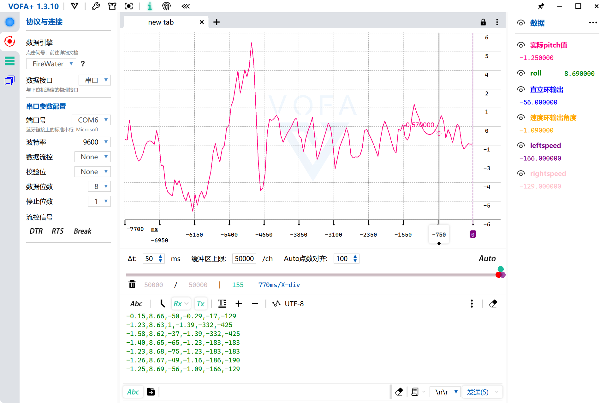
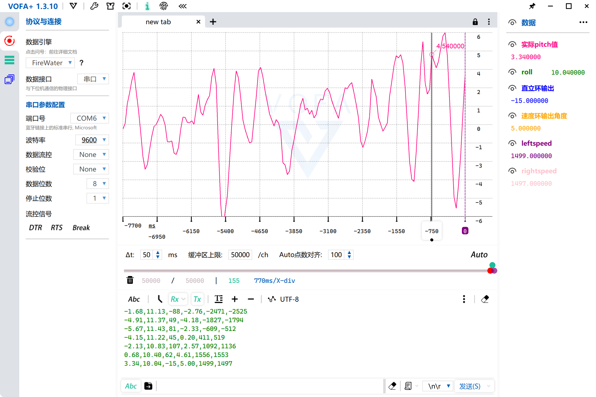
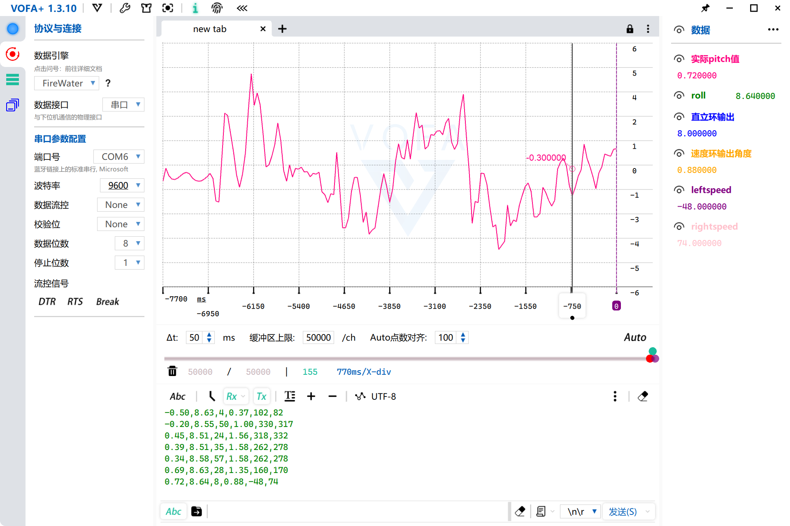

# Balance_Car —— 基于 STM32 的两轮自平衡小车

以 STM32F103 为主控的两轮自平衡小车，采用 **直立环 PD + 速度环 PI** 串级控制架构，支持蓝牙在线调参与 VOFA+ 波形调试。

## 演示 Demo

> [基于 HAL 库的 STM32 双环自平衡小车（B站演示）](https://b23.tv/vLEOcep)
>
> 内容：原地驻留 → 手推扰动后恢复 → 直线行驶

## 系统架构

```
                 ┌──────────────────┐
 MPU6050 ──I2C1──► 互补滤波 ──► 姿态角/角速度 ─┐
                 └──────────────────┘           │
                                                ▼
 编码器 ──► 测速 ──► 速度环(PI·50ms) ──► 目标倾角 ──► 直立环(PD·10ms，实测dt) ─┐
                                                                          ├─► PWM合成 ─► TB6612FNG ─► 电机
 HC-05蓝牙 ◄──► 在线调参命令 / 运行数据回传(VOFA+)
```

- **直立环（内环，10ms）**：PD 控制。TIM1 每 10ms 产生更新中断并置标志，主循环消费标志后执行控制；`dt` 由 `HAL_GetTick()` 实测（限幅 1~20ms），采样抖动或漏拍不会再让 D 项算错。
- **速度环（外环，50ms）**：PI 控制，由 `HAL_GetTick()` 每 50ms 触发；输出叠加到直立环目标倾角（限幅 ±5°，防止外环带崩内环），并带积分限幅。
- **遥测**：每 50ms 通过 HC-05 输出 6 个通道（pitch、roll、直立环输出、角度修正、左右轮速），供 VOFA+ 波形显示。
- **注意**：当前版本未实现倾倒保护（|倾角| > 30° 断电机）与急停，调试时需手动断电。

## 硬件清单

| 模块 | 型号 |
|---|---|
| 主控 | STM32F103C8T6 核心板 |
| 姿态传感器 | MPU6050（I2C1：PB8/PB9） |
| 电机驱动 | TB6612FNG |
| 电机 | N20 减速电机（带编码器）×2 |
| 无线通信 | HC-05 蓝牙模块（9600 8N1） |
| 电源 | 18650×2 + 稳压模块 |
| 调试工具 | ST-Link、USB 逻辑分析仪 |

## 姿态解算

互补滤波：加速度计（atan2）负责长期锚定，陀螺仪积分负责短期响应。

```
angle(k) = 0.98 × [angle(k-1) + gyro(k)·dt] + 0.02 × angle_accel(k)
```

- `dt` 为实测控制周期（约 10ms），由 `HAL_GetTick()` 计算；
- 上电延时 0.5s 等待传感器稳定，并用 `MPU6050_CalibrateZero()` 做加速度计角度零位校准，运行中扣除。

## 软件结构

```
├── mpu6050.c     # MPU6050 驱动（硬件 I2C1）、互补滤波、零位校准
├── pid.c         # 通用 PID（结构体封装，支持积分限幅、输出限幅）
├── control.c     # 双环调度与输出合成（直立环 + 速度环）
├── motor.c       # 电机 PWM / 方向控制
├── encoder.c     # 编码器计数与测速（TIM 编码器接口模式）
├── bluetooth.c   # 蓝牙文本命令解析、遥测输出
└── main.c        # 初始化、10ms 控制循环与 50ms 任务调度
```

## 关键参数

| 参数 | 值 |
|---|---|
| 直立环 | Kp = 99.0，Kd = 1.0，Ki 未启用 |
| 目标倾角 | -0.6°（可由蓝牙 `tr` 在线修改） |
| 速度环 | Kp = 0.005，Ki = 0.005，输出限幅 ±5° |
| 控制周期 | 直立环 10ms（实测 dt），速度环/遥测 50ms |
| 电机输出 | PWM 范围 ±999 |
| 通信 | HC-05，9600 8N1，文本命令 + 50ms 遥测 |

## 调试记录（Debug Log）

### 1. MPU6050 读取失败：硬件 I2C 卡死

**现象**：初始化后读回数据恒为 0/0xFFFF。
**排查**：控制变量法逐段排除——蓝牙链路正常、更换引脚无效，示波器/逻辑分析仪确认总线被拉死。
**定位**：硬件 I2C 外设状态机锁死（从机异常拉低 SDA 所致）。
**解决**：改用 GPIO 软件模拟 I2C 时序，通信恢复稳定；后续版本恢复使用硬件 I2C1（PB8/PB9），见 `i2c.c`。

### 2. 编码器信号丢失：主控 GPIO 引脚损坏

**现象**：单侧编码器无计数。
**排查**：依次排除蓝牙、电机本体、驱动模块与接线（对调验证）。
**定位**：主控该 GPIO 引脚损坏（静电/过流）。
**解决**：查阅数据手册，利用 TIM 复用功能将编码器通道重映射至备用引脚。

### 3. 速度环久调不通：从盲调到数据驱动

**现象**：速度环加入后整车前后振荡或跑飞，长期无法收敛。
**复盘**：①缺乏测量手段，纯靠手感盲调；②单环结构下参数互相耦合。
**解决**：引入 VOFA+ 上位机实时波形（目标速度/实际速度/倾角三曲线同屏），按串级控制理论重构：直立环 PD 作内环、速度环 PI 作外环并加积分限幅，最终实现原地驻留与受推扰动后自动恢复。

### 4. 控制周期与 dt 不一致（10ms vs 5ms）

**现象**：小车能保持平衡，但会以约 2s 周期前后蠕动；受推后长时间来回、轮速残差大。
**分析**：TIM1 实际配置为 PSC=71、ARR=9999 → 72MHz/72/10000 = **10ms**，但代码里 `Control_BalanceLoop(0.005f)` 写死 5ms，D 项等效增益变为

```
Kd_eff = Kd × T_s / dt = 0.5 × 0.010 / 0.005 = 1.0
```

即名义值的 2 倍；互补滤波的陀螺积分同样只有真实值的一半。速度环使用 `HAL_GetTick()` 每 50ms 触发，未受影响。

**修正**：

- `dt` 改为用 `HAL_GetTick()` 实测的间隔（限幅 1~20ms），控制周期保持 10ms；
- 直立环 `Kd` 0.5 → 1.0，保持 `Kd_eff = 1.0`，不改变整车阻尼；
- 速度环 `Kp` 0.003 → 0.005，抑制 2s 蠕动。

**效果**（VOFA+ FireWater，Δt=50ms，Y 轴固定 -6~6）：

| 指标 | 旧版 | 新版 |
|---|---|---|
| 静止时末端轮速（counts/50ms） | 306 / 211 | -16 / -71 |
| 前推后残余轮速 | 704 / 708 | -166 / -129 |
| 后推后残余轮速 | 1499 / 1497 | -48 / 74 |
| 推后行为 | 持续来回，不收敛 | 约 1~2s 收敛到 ±1° |

| 旧版静止 | 新版静止 |
|---|---|
|  |  |

| 旧版前推 | 新版前推 |
|---|---|
|  |  |

| 旧版后推 | 新版后推 |
|---|---|
|  |  |

### 调通前后波形对比


## 蓝牙在线调参

HC-05 使用 **9600 8N1**，命令为文本行（以 `\r\n` 结尾）：

```
kp=9900,kd=50    → 直立环 Kp=99.00, Kd=0.50
tr=-60           → 目标倾角 -0.60°
skp=...,ski=...  → 速度环参数（当前版本建议直接修改 control.c 后重新编译）
```

直立环参数与目标角可在线生效；速度环参数以 `Control_Init()` 中的默认值为准。

## 快速开始

1. 环境：STM32CubeIDE（本工程使用 1.19.0 验证）
2. 克隆仓库，直接打开工程编译
3. ST-Link 烧录，按接线表连接各模块
4. 手机蓝牙连接 HC-05，用【VOFA+】查看波形 / 发送调参命令

## Roadmap

- [x] 直立环 PD 自平衡
- [x] 速度环 PI 原地驻留
- [x] 直线行驶（左右轮同速）
- [x] 蓝牙在线调参 + VOFA+ 波形调试
- [x] 控制周期与 dt 一致性修正（实测 dt + Kd 重标定）
- [x] 速度环 Kp 整定，消除 2s 低速蠕动
- [ ] 定点驻留（位置环）
- [ ] 5ms 控制周期对比实验
- [ ] 倾倒保护 / 急停

## License

MIT
