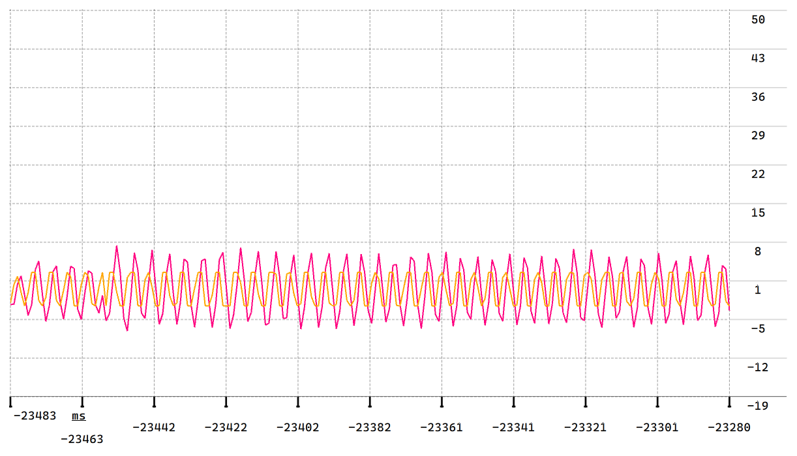
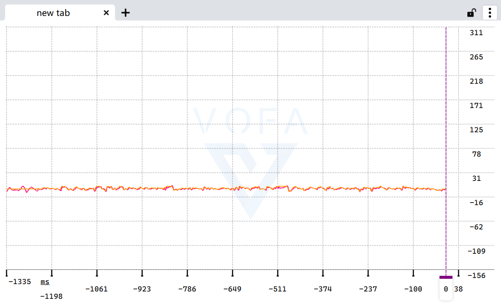

# Balance_Car —— 基于 STM32 的两轮自平衡小车

以 STM32F103 为主控的两轮自平衡小车，采用 **直立环PD + 速度环PI**
串级控制架构，支持蓝牙遥控、PID 在线调参与 VOFA+ 波形调试。

## 演示 Demo

> [基于 HAL 库的 STM32 双环自平衡小车（B站演示）](https://b23.tv/vLEOcep)
>
> 内容：原地驻留 → 手推扰动后恢复 → 蓝牙遥控定速行驶、走直线

## 系统架构

```
                 ┌──────────────┐
 MPU6050 ──软件I2C──► 互补滤波 ──► 姿态角/角速度 ─┐
                 └──────────────┘                │
                                                 ▼
 编码器 ──► 测速 ──► 速度环(PI·50ms) ──► 目标倾角 ──► 直立环(PD·5ms) ─┐
                                                                     ├─► PWM合成 ─► TB6612 ─► 电机

 HC-05蓝牙 ◄──► 遥控指令 / PID在线调参 / 运行数据回传(VOFA+)
```

- **直立环（内环，5ms）**：PD 控制。D 项直接使用陀螺仪角速度（微分先行），
  避免对误差求导放大噪声及目标值阶跃带来的微分冲击
- **速度环（外环，50ms）**：PI 控制，输出叠加到直立环目标倾角（限幅 ±5°，
  防止外环带崩内环）；带积分限幅与积分分离
- **倾倒保护**：|倾角| > 30° 时关闭电机输出
- **调度方式**：TIM 定时中断 5ms 进入，软件计数分频出 50ms 任务

## 硬件清单

| 模块 | 型号 |
|---|---|
| 主控 | STM32F103C8T6 核心板 |
| 姿态传感器 | MPU6050 |
| 电机驱动 | TB6612FNG |
| 电机 | N20 减速电机（带编码器）×2 |
| 无线通信 | HC-05 蓝牙模块 |
| 电源 | 18650×2 + 稳压模块 |
| 调试工具 | ST-Link、USB 逻辑分析仪 |


## 姿态解算

互补滤波，加速度计（atan2）负责长期锚定，陀螺仪积分负责短期响应：

```
angle(k) = 0.98 × [angle(k-1) + gyro(k)·dt] + 0.02 × angle_accel(k)
```

- dt 取自真实控制周期（5ms 定时中断）
- 上电静止 1s 采集陀螺仪零偏，运行中实时扣除

## 软件结构

```
├── mpu6050.c     # MPU6050 驱动（GPIO 软件模拟 I2C）
├── filter.c      # 互补滤波 + 零偏校准
├── pid.c         # 通用 PID（结构体封装，支持积分限幅/分离、输出限幅）
├── control.c     # 三环调度与输出合成（TIM 中断）
├── motor.c       # 电机 PWM / 方向控制
├── encoder.c     # 编码器计数与测速（TIM 编码器接口模式）
└── bluetooth.c   # 蓝牙收发、自定义帧解析、在线调参
```


## 调试记录（Debug Log）

### 1. MPU6050 读取失败：硬件 I2C 卡死

**现象**：初始化后读回数据恒为 0/0xFFFF。
**排查**：控制变量法逐段排除——蓝牙链路正常、更换引脚无效，示波器/逻辑分析
仪确认总线被拉死。
**定位**：硬件 I2C 外设状态机锁死（从机异常拉低 SDA 所致）。
**解决**：改用 GPIO 软件模拟 I2C 时序，通信恢复稳定。

### 2. 编码器信号丢失：主控 GPIO 引脚损坏

**现象**：单侧编码器无计数。
**排查**：依次排除蓝牙、电机本体、驱动模块与接线（对调验证）。
**定位**：主控该 GPIO 引脚损坏（静电/过流）。
**解决**：查阅数据手册，利用 TIM 复用功能将编码器通道重映射至备用引脚。

### 3. 速度环久调不通：从盲调到数据驱动

**现象**：速度环加入后整车前后振荡或跑飞，长期无法收敛。
**复盘**：①缺乏测量手段，纯靠手感盲调；②单环结构下参数互相耦合。
**解决**：引入 VOFA+ 上位机实时波形（目标速度/实际速度/倾角三曲线同屏），
按串级控制理论重构：直立环 PD 作内环、速度环 PI 作外环并加积分限幅，
最终实现原地驻留与受推扰动后自动恢复。

### 调通前后波形对比



## 蓝牙在线调参

自定义帧格式：

```
帧头(0xAA) | 命令字(环/参数) | 数据(float) | 校验
```


## 快速开始

1. 环境：STM32CubeIDE 
2. 克隆仓库，直接打开工程编译
3. ST-Link 烧录，按接线表连接各模块
4. 手机蓝牙连接 HC-05，【VOFA+】发送指令

## Roadmap

- [x] 直立环 PD 自平衡
- [x] 速度环 PI 原地驻留 / 遥控定速
- [x] 转向环走直线
- [x] 蓝牙在线调参 + VOFA+ 波形调试
## License

MIT